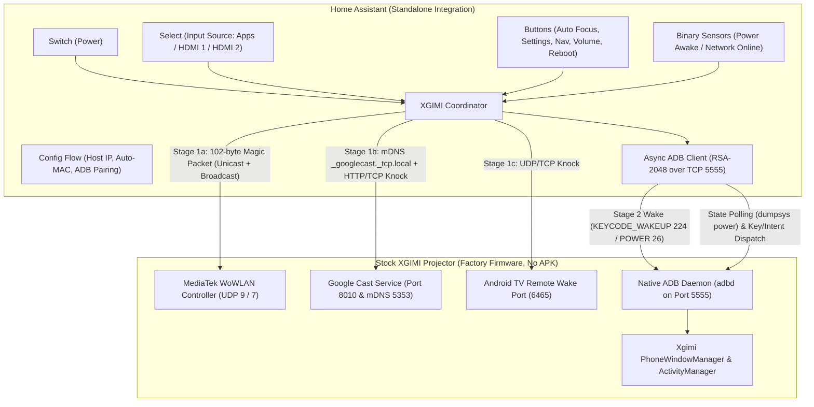

# Implementation Plan: Standalone XGIMI Home Assistant (HACS) Integration

## 1. Executive Summary

This plan outlines the architecture, extraction, and implementation steps to build an independent, HACS-compatible Home Assistant integration for **XGIMI Google TV / Android 14 projectors** (tested on the **XGIMI Horizon 20** series, `XR14A` / MediaTek `MT9689`, which dropped legacy UDP ports `16735`/`16750`).

The integration operates **100% natively against factory stock XGIMI firmware** with **ADB over TCP (port `5555`) enabled**, requiring **no [`xgimi-bridge`](https://github.com/Weidav/xgimi-bridge) Android APK** or third-party software installed on the projector.



---

## 2. Capability Matrix: `xgimi-bridge` APK vs. Standalone Integration (Stock + ADB)

| Feature | In `xgimi-bridge` (APK Installed) | In Standalone Integration (Stock + ADB 5555) | Mechanism Without Bridge APK |
| :--- | :---: | :---: | :--- |
| **Two-Stage WoWLAN Standby Wake** | Supported | **Fully Supported** | **Stage 1 (SoC/Wi-Fi Wake)**: 102-byte Magic Packet (UDP 9/7) + mDNS Cast query (5353) + UDP/TCP/HTTP knocks (8010, 6465)<br>**Stage 2 (Display Wake)**: ADB `input keyevent 224` (`KEYCODE_WAKEUP`) / `26` (`KEYCODE_POWER`) once port 5555 responds |
| **MAC Auto-Discovery** | Supported | **Fully Supported** | Local ARP table inspection (`/proc/net/arp`) + fallback via ADB `ip link show wlan0` |
| **True Power vs. Standby Detection** | Supported | **Fully Supported** | ADB `dumpsys power` (`mWakefulness=Awake` vs `Asleep`/`Dozing`) — avoids false `awake=True` when network stays up in Fast Boot standby |
| **Idempotent Turn Off / Standby** | Supported | **Fully Supported** | Verified `Awake` state via `dumpsys power` before injecting `KEYCODE_POWER` (`26`) so repeated calls never double-toggle |
| **Remote & XGIMI Custom Keys** | Supported | **Fully Supported** | ADB key injection including XGIMI-intercepted keys: **Auto Focus** (`140` / `KEYCODE_F10`), **Settings** (`176`), **Power** (`26`), **Assistant** (`219`), D-pad, Volume, Mute |
| **Input Source Switching** | Supported | **Fully Supported** | ADB `am start` with `content://android.media.tv/passthrough/<inputId>` for HDMI 1/2, and `am force-stop com.google.android.tv.inputplayer` + `CATEGORY_HOME` for Apps |
| **Active App / Input Telemetry** | Supported | **Fully Supported** | ADB `getprop sys.mtk.running.application` & `settings get global running_package_name` |
| **Reboot Projector** | Supported | **Fully Supported** | ADB `setprop sys.powerctl reboot` / `svc power reboot` |
| **Picture Sliders & Modes (`com.xgimi.xgimiservice`)** | Supported | *Out of Scope for v1* | Bound via system-UID Binder in APK (`AidlClient.java`); optional future phase via `CLASSPATH=/system_ext/framework/com.xgimi.api.jar app_process` over ADB |

---

## 3. Core Hardware & Firmware Facts (Derived from `xgimi-bridge`)

Any implementation must respect the following hardware behaviors proven in [`Weidav/xgimi-bridge`](https://github.com/Weidav/xgimi-bridge):

1. **Why Wake Requires Two Stages ([`coordinator.py#L352-L448`](https://github.com/Weidav/xgimi-bridge/blob/main/homeassistant/custom_components/xgimi_bridge/coordinator.py#L352-L448), [`spec.md#L161`](https://github.com/Weidav/xgimi-bridge/blob/main/spec.md#L161))**:
   - WoWLAN network stimuli (Magic Packets on UDP `9`/`7`, mDNS `_googlecast._tcp.local` queries on `224.0.0.251:5353`, and UDP/TCP/HTTP knocks on `8010` and `6465`) **only wake the MediaTek Wi-Fi radio and CPU** out of deep sleep.
   - They **do not** ignite the laser/display by themselves. Once the CPU wakes and `adbd` (port `5555`) accepts connections, the integration must inject `KEYCODE_WAKEUP` (`224`) / `KEYCODE_POWER` (`26`) to turn the display on.
2. **Why Polling TCP Ports `8010`/`6466` for Power State Fails ([`DeviceState.java#L13-L17`](https://github.com/Weidav/xgimi-bridge/blob/main/app/src/com/xgimi/bridge/DeviceState.java#L13-L17), [`README.md#L213`](https://github.com/Weidav/xgimi-bridge/blob/main/README.md#L213))**:
   - In **Fast Boot / Network Standby** mode, Android turns the display off (`PowerManager.isInteractive() == false`) while the network stack often remains responsive. Probing TCP port `8010` or `6466` cannot distinguish `awake` from `standby`.
   - Worse, opening a TCP connection to port `8010` or `6465` is itself a WoWLAN wake trigger ([`_send_tcp_knock()`](https://github.com/Weidav/xgimi-bridge/blob/main/homeassistant/custom_components/xgimi_bridge/coordinator.py#L154-L165)); polling those ports every 10s prevents the SoC from sleeping.
   - Instead, state polling must run over the ADB session (`dumpsys power`), which cleanly distinguishes:
     - `online=True, awake=True` (`mWakefulness=Awake`)
     - `online=True, awake=False` (`mWakefulness=Asleep` or `Dozing` in Network Standby)
     - `online=False, awake=False` (deep sleep / unreachable)
3. **Why `KEYCODE_POWER` (`26`) Must Be State-Guarded ([`DeviceCommands.java#L182-L203`](https://github.com/Weidav/xgimi-bridge/blob/main/app/src/com/xgimi/bridge/DeviceCommands.java#L182-L203), [`README.md#L57-L63`](https://github.com/Weidav/xgimi-bridge/blob/main/README.md#L57-L63))**:
   - XGIMI's `PhoneWindowManager.interceptKeyBeforeDispatching` intercepts `KEYCODE_POWER` (`26`) to toggle projector standby.
   - `turn_on` and `turn_off` must verify current wakefulness first so concurrent or repeated calls never toggle the projector in the wrong direction.
4. **Why Vendor AIDL Input Switching Fails ([`InputService.java#L55-L92`](https://github.com/Weidav/xgimi-bridge/blob/main/app/src/com/xgimi/bridge/InputService.java#L55-L92), [`README.md#L215`](https://github.com/Weidav/xgimi-bridge/blob/main/README.md#L215))**:
   - `switchToSignalSource` is a non-functional stub on Horizon 20 firmware.
   - Switching to HDMI requires launching `Intent.ACTION_VIEW` on `content://android.media.tv/passthrough/<inputId>` for the root hardware `TvInputInfo`.
   - Switching back to Android TV (`Apps` / `HOME`) requires **both** `am force-stop com.google.android.tv.inputplayer` and launching `android.intent.category.HOME`, otherwise the HDMI passthrough player holds the screen.
5. **Why Native ADB Is Used Instead of Google TV Remote Port `6466` ([`README.md#L32-L53`](https://github.com/Weidav/xgimi-bridge/blob/main/README.md#L32-L53), [`LocalAdbClient.java`](https://github.com/Weidav/xgimi-bridge/blob/main/app/src/com/xgimi/bridge/LocalAdbClient.java))**:
   - ADB over TCP (`5555`) uses a simple RSA-2048 challenge-response handshake (`A_CNXN`, `A_AUTH`, `A_OPEN`, `A_WRTE`), requires only a one-time on-screen **"Always allow from this computer"** click, persists authorization in `/data/misc/adb/adb_keys` across reboots, and provides full `shell` UID capabilities (wakefulness inspection, key injection, HDMI passthrough intents, and system properties).

---

## 4. Component Architecture & Repository Layout

```text
xgimi-hacs/
├── .devcontainer/
│   └── devcontainer.json              # Python 3.14-trixie + uv + common-utils (vscode) + agy
├── .vscode/
│   └── settings.json                  # Ruff formatter, pytest, interpreter path
├── .github/
│   └── workflows/
│       ├── validate.yml               # HACS validation & Home Assistant hassfest
│       └── release.yml                # Automated GitHub release packaging
├── custom_components/
│   └── xgimi/
│       ├── __init__.py                # Entry setup, unload lifecycle, device registry
│       ├── manifest.json              # Domain: xgimi, iot_class: local_polling
│       ├── const.py                   # Wake ports (9, 7, 8010, 6465, 5353), ADB port (5555), XGIMI keycodes
│       ├── adb_client.py              # Async Python port of LocalAdbClient.java (RSA-2048 ADB wire protocol)
│       ├── config_flow.py             # Host IP, auto-MAC, interactive ADB authorization step + OptionsFlow
│       ├── coordinator.py             # Two-stage wake engine, ADB state polling, input & key dispatch
│       ├── switch.py                  # Idempotent projector power switch
│       ├── binary_sensor.py           # Power state (awake) and Connectivity (online)
│       ├── select.py                  # Input Source select (Apps, HDMI 1, HDMI 2)
│       ├── button.py                  # Auto Focus (140), Settings (176), Home, Back, Menu, Vol, Mute, Reboot
│       ├── strings.json               # Config flow & entity translations
│       └── translations/
│           └── en.json
├── tests/
│   ├── conftest.py                    # Home Assistant test fixtures
│   ├── test_adb_client.py             # ADB wire handshake, auth probe, shell execution tests
│   ├── test_config_flow.py            # IP validation, MAC auto-discovery, ADB pairing flow, OptionsFlow
│   ├── test_coordinator.py            # Two-stage wake, state polling, idempotent power off, unload cleanup
│   └── test_entities.py               # Switch, select, button, and binary_sensor behavior & error surfacing
├── hacs.json                          # HACS metadata configuration
├── pyproject.toml                     # uv project & dependency-groups (homeassistant, pytest, ruff)
└── README.md                          # Setup, projector Standby & ADB prerequisites, entity reference
```

---

## 5. Phase-by-Phase Implementation Plan

### Phase 1: Async ADB Wire Client (`adb_client.py`)
Port the proven ADB wire implementation from [`LocalAdbClient.java`](https://github.com/Weidav/xgimi-bridge/blob/main/app/src/com/xgimi/bridge/LocalAdbClient.java) into an async Python module using Home Assistant's built-in `cryptography` package (zero external ADB pip dependency conflicts):
1. **RSA-2048 Keypair Management** ([`LocalAdbClient.java#L400-L445`](https://github.com/Weidav/xgimi-bridge/blob/main/app/src/com/xgimi/bridge/LocalAdbClient.java#L400-L445) & [`encodeAdbPublicKey()`](https://github.com/Weidav/xgimi-bridge/blob/main/app/src/com/xgimi/bridge/LocalAdbClient.java#L550-L575)):
   - Generate and persist a single 2048-bit RSA keypair in Home Assistant's `.storage/xgimi_adb_key` so authorization survives HA container rebuilds and restarts.
2. **Non-Prompting Probe vs. Interactive Pairing** ([`handshake()`](https://github.com/Weidav/xgimi-bridge/blob/main/app/src/com/xgimi/bridge/LocalAdbClient.java#L498-L530)):
   - `async_is_authorized()`: Sends `AUTH_SIGNATURE` with `prompt_on_reject=False` ([`LocalAdbClient.java#L192-L215`](https://github.com/Weidav/xgimi-bridge/blob/main/app/src/com/xgimi/bridge/LocalAdbClient.java#L192-L215)).
   - `async_authorize(timeout=30.0)`: Sends `AUTH_RSAPUBLICKEY` when signature is rejected, surfacing the on-screen **"Allow USB debugging from this computer?"** prompt on the projector and waiting for the user to click **Always allow -> OK** ([`LocalAdbClient.java#L168-L181`](https://github.com/Weidav/xgimi-bridge/blob/main/app/src/com/xgimi/bridge/LocalAdbClient.java#L168-L181)).
3. **Shell Execution & Fast Key Injection**:
   - `async_shell(command)`: Executes bounded shell commands over `shell:<cmd>\0` streams (`A_OPEN` / `A_WRTE` / `A_OKAY` / `A_CLSE`).
   - Persistent or pooled shell channel for low-latency key events (`input keyevent <code>`).

### Phase 2: Two-Stage Wake & ADB Coordinator (`coordinator.py`)
Extract all network wake routines from [`coordinator.py`](https://github.com/Weidav/xgimi-bridge/blob/main/homeassistant/custom_components/xgimi_bridge/coordinator.py) and pair them with ADB stage-2 wake and state polling:
1. **Stage 1 — Multi-Vector WoWLAN Network Burst**:
   - **MAC Formatting & 102-Byte Magic Packet**: [`format_mac()`](https://github.com/Weidav/xgimi-bridge/blob/main/homeassistant/custom_components/xgimi_bridge/coordinator.py#L40-L48) and [`create_magic_packet()`](https://github.com/Weidav/xgimi-bridge/blob/main/homeassistant/custom_components/xgimi_bridge/coordinator.py#L50-L57).
   - **Auto-ARP MAC Discovery**: [`resolve_mac_from_arp()`](https://github.com/Weidav/xgimi-bridge/blob/main/homeassistant/custom_components/xgimi_bridge/coordinator.py#L59-L84) reading `/proc/net/arp`, plus automatic fallback via ADB (`cat /sys/class/net/wlan0/address`) whenever connected so MAC is learned even across routed VLANs/Docker bridge networks!
   - **Unicast + Broadcast UDP Knocks**: [`_send_udp_knock()`](https://github.com/Weidav/xgimi-bridge/blob/main/homeassistant/custom_components/xgimi_bridge/coordinator.py#L86-L120) to ports `9` (`WOL_WAKE_PORT`), `7` (`WOL_DISCARD_PORT`), `8010` (`CAST_WAKE_PORT`), and `6465` (`REMOTE_WAKE_PORT`) ([`const.py#L10-L16`](https://github.com/Weidav/xgimi-bridge/blob/main/homeassistant/custom_components/xgimi_bridge/const.py#L10-L16)).
   - **Google Cast mDNS PTR Query**: [`MDNS_CAST_QUERY` & `_send_mdns_knock()`](https://github.com/Weidav/xgimi-bridge/blob/main/homeassistant/custom_components/xgimi_bridge/coordinator.py#L123-L152) to `224.0.0.251:5353`.
   - **Cast HTTP & TCP SYN Knocks**: [`_send_cast_http_knock()`](https://github.com/Weidav/xgimi-bridge/blob/main/homeassistant/custom_components/xgimi_bridge/coordinator.py#L310-L325), [`_send_tcp_knock()`](https://github.com/Weidav/xgimi-bridge/blob/main/homeassistant/custom_components/xgimi_bridge/coordinator.py#L154-L165), and [`_send_wowlan_knocks()`](https://github.com/Weidav/xgimi-bridge/blob/main/homeassistant/custom_components/xgimi_bridge/coordinator.py#L326-L350).
2. **Stage 2 — 24-Second Wake Loop & ADB Display Ignition**:
   - Modeled on [`async_turn_on()`](https://github.com/Weidav/xgimi-bridge/blob/main/homeassistant/custom_components/xgimi_bridge/coordinator.py#L352-L448):
     - Fire `_send_wowlan_knocks()` initially and every 2nd attempt while polling ADB (`<host>:5555`) up to a 24s deadline.
     - Once ADB responds, inspect wakefulness and send `input keyevent 224` (`KEYCODE_WAKEUP`) + `input keyevent 26` (`KEYCODE_POWER` if still asleep) to turn on the projector display.
     - Set `_power_transition_until = time.monotonic() + 10.0` ([`coordinator.py#L200`](https://github.com/Weidav/xgimi-bridge/blob/main/homeassistant/custom_components/xgimi_bridge/coordinator.py#L200)) and schedule 3s / 6s delayed refreshes.
3. **Idempotent `async_turn_off()`**:
   - Query `dumpsys power` over ADB; if `mWakefulness=Awake`, inject `input keyevent 26` (`KEYCODE_POWER`) ([`DeviceCommands.java#L193-L202`](https://github.com/Weidav/xgimi-bridge/blob/main/app/src/com/xgimi/bridge/DeviceCommands.java#L193-L202)). If already asleep, succeed without toggling.
4. **Single-Command Poll Cycle (`_async_update_data`)**:
   - Run a single compound shell one-liner over ADB every 10s to minimize overhead:
     - Wakefulness (`dumpsys power | grep -E 'mWakefulness=|Display Power'`)
     - Active package (`getprop sys.mtk.running.application` / `settings get global running_package_name` from [`DeviceState.java#L19-L36`](https://github.com/Weidav/xgimi-bridge/blob/main/app/src/com/xgimi/bridge/DeviceState.java#L19-L36))
     - Hardware metadata & MAC (`getprop ro.product.model`, `getprop ro.build.version.release`, `/sys/class/net/wlan0/address` on first connect).

### Phase 3: Entities (`switch.py`, `binary_sensor.py`, `select.py`, `button.py`)
1. **Power Switch ([`switch.py`](https://github.com/Weidav/xgimi-bridge/blob/main/homeassistant/custom_components/xgimi_bridge/switch.py#L28-L53))**:
   - `is_on`: Reflects `coordinator.data["awake"]`.
   - `async_turn_on()` / `async_turn_off()`: Calls coordinator and raises `HomeAssistantError` on failure ([`spec.md#L283`](https://github.com/Weidav/xgimi-bridge/blob/main/spec.md#L283)).
2. **Binary Sensors ([`binary_sensor.py`](https://github.com/Weidav/xgimi-bridge/blob/main/homeassistant/custom_components/xgimi_bridge/binary_sensor.py))**:
   - `Power State` (`BinarySensorDeviceClass.POWER`): `True` when projector display is awake.
   - `Connectivity` (`BinarySensorDeviceClass.CONNECTIVITY`): `True` when ADB is reachable.
3. **Input Source Select (`select.py`)**:
   - Options: `Apps`, `HDMI 1`, `HDMI 2` ([`const.py#L18-L27`](https://github.com/Weidav/xgimi-bridge/blob/main/homeassistant/custom_components/xgimi_bridge/const.py#L18-L27)).
   - Switching logic from [`InputService.java#L55-L92`](https://github.com/Weidav/xgimi-bridge/blob/main/app/src/com/xgimi/bridge/InputService.java#L55-L92):
     - Discover passthrough IDs via `dumpsys tv_input` (matching `hdmiPortId` 1 and 2 with no parent ID).
     - `HDMI 1` / `HDMI 2`: `am start -a android.intent.action.VIEW -d "content://android.media.tv/passthrough/<inputId>"`
     - `Apps`: `am force-stop com.google.android.tv.inputplayer && am start -a android.intent.action.MAIN -c android.intent.category.HOME`
4. **Buttons ([`button.py`](https://github.com/Weidav/xgimi-bridge/blob/main/homeassistant/custom_components/xgimi_bridge/button.py), [`const.py#L82-L92`](https://github.com/Weidav/xgimi-bridge/blob/main/homeassistant/custom_components/xgimi_bridge/const.py#L82-L92))**:
   - `Auto Focus` (`140` / `KEYCODE_F10`)
   - `Settings Dashboard` (`176` / `KEYCODE_SETTINGS`)
   - `Home` (`3`), `Back` (`4`), `Menu` (`82`), `Volume Up` (`24`), `Volume Down` (`25`), `Mute` (`164`), `Assistant` (`219`)
   - `Wake Projector` (triggers two-stage wake burst on demand)
   - `Restart Projector` (`setprop sys.powerctl reboot` / `svc power reboot`, `EntityCategory.CONFIG`)

### Phase 4: Config Flow & Options Flow (`config_flow.py`)
Modeled on [`config_flow.py`](https://github.com/Weidav/xgimi-bridge/blob/main/homeassistant/custom_components/xgimi_bridge/config_flow.py) and hardened per [`spec.md#L281-L289`](https://github.com/Weidav/xgimi-bridge/blob/main/spec.md#L281-L289):
1. **Step 1 (`user`)**:
   - Inputs: `host` (validated IPv4/IPv6/hostname, no scheme/path), `name` (default: `"XGIMI Horizon 20"`), optional `mac` (auto-resolved via ARP or ADB `wlan0` if omitted).
   - If the projector is asleep during setup, fire `_send_wowlan_knocks()` first to wake the network interface.
2. **Step 2 (`authorize` — if ADB key is not yet in `/data/misc/adb/adb_keys`)**:
   - Triggers the on-screen ADB Allow prompt on the projector and instructs the user: *"Check your projector screen and select 'Always allow from this computer' -> OK, then click Submit."*
3. **Options Flow (`XgimiOptionsFlowHandler`)**:
   - Uses HA's modern zero-arg `XgimiOptionsFlowHandler()` pattern (`self.config_entry` property, [`spec.md#L281`](https://github.com/Weidav/xgimi-bridge/blob/main/spec.md#L281)) to reconfigure `host` and `mac` at any time.

### Phase 5: Automated Test Suite
Port and expand the test suite from [`tests/ha/test_ha_integration.py`](https://github.com/Weidav/xgimi-bridge/blob/main/tests/ha/test_ha_integration.py):
1. Magic packet & MAC/ARP helpers ([`test_ha_integration.py#L80-L108`](https://github.com/Weidav/xgimi-bridge/blob/main/tests/ha/test_ha_integration.py#L80-L108)).
2. Multi-vector WoWLAN knock verification ([`test_ha_integration.py#L310-L321`](https://github.com/Weidav/xgimi-bridge/blob/main/tests/ha/test_ha_integration.py#L310-L321)).
3. ADB RSA-2048 handshake, non-prompting auth probe, and shell execution (`test_adb_client.py`).
4. Two-stage wake loop (WoWLAN burst -> ADB wakeup keyevent) and idempotent `turn_off` (`test_coordinator.py`).
5. Modern `OptionsFlow` instantiation, unload timer cancellation, and `HomeAssistantError` surfacing on failed commands.
